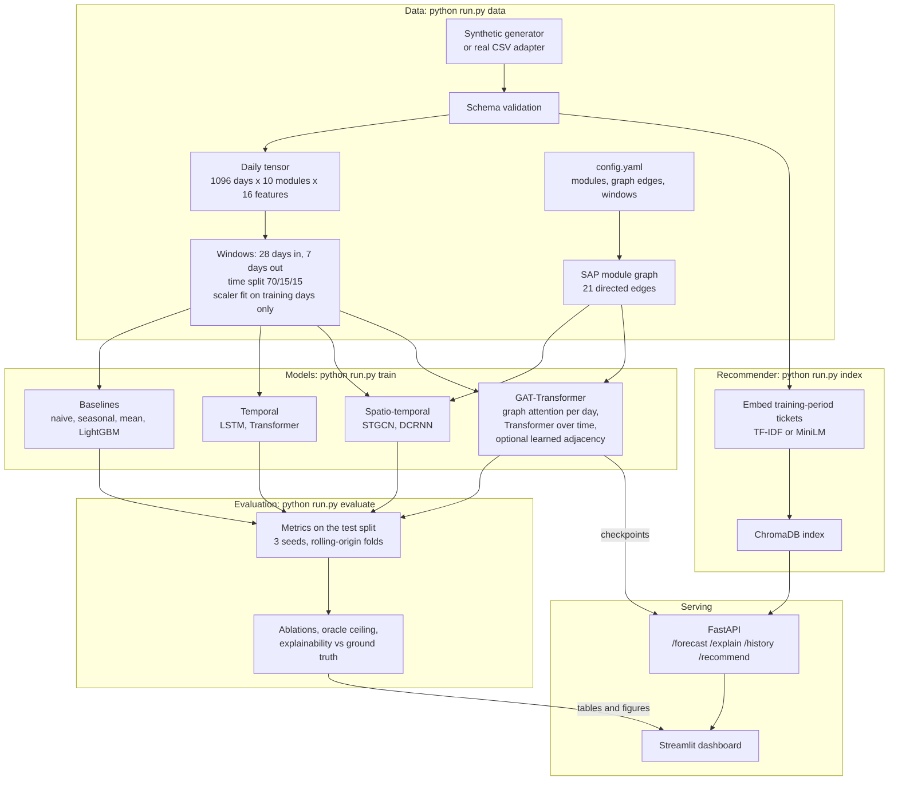

# SAP-Centric Predictive Incident Resolution System

M.Tech (AI & ML) capstone. The system forecasts where IT incidents are likely to occur
across ten SAP modules (FI, CO, SD, MM, PP, WM, QM, PM, HCM, BASIS) over the next 7 days,
and suggests fixes from similar past incidents.

> **SYNTHETIC DATA.** No real SAP ticket data is included. Every incident, ticket text,
> daily signal, forecast and metric in this repository comes from data generated by
> `src/data/generate_synthetic.py` from the assumptions in `configs/config.yaml` (section
> `synthetic`). The numbers say nothing about a real SAP system. An adapter for real CSV
> exports (`src/data/load_real.py`) is included; it has been tested only on small made-up
> files.

## Problem

SAP modules depend on each other: SD billing posts to FI, MM goods movements feed FI and
CO, and BASIS carries everything. A problem in one module can cause incidents in others a
few days later. Two questions follow:

1. **Forecast:** for each module and each of the next 7 days, how many incidents are
   expected, and how likely is at least one high-priority (P1/P2) incident?
2. **Resolve:** for a new ticket, or for a module flagged by the forecast, which past
   incidents are similar, and how were they fixed?

## Approach

- The modules form a **graph** (21 hand-built dependency edges) and their daily incident
  history is a **time series**. The main model, a **GAT-Transformer**, applies a graph
  attention layer to each day (information flows along dependencies) and a Transformer over
  the 28-day history of each module. It can also learn its own adjacency matrix.
- It is compared with **simple baselines** (naive, seasonal naive, historical mean), a
  **LightGBM** model on tabular features, two **temporal** networks without a graph (LSTM,
  Transformer) and two **spatio-temporal** networks from the literature (STGCN, DCRNN).
- All models are scored on the same chronological test split, neural models over 3 seeds.
- The synthetic generator has a **known propagation mechanism**, saved as ground truth. So
  two things can be checked that real data never allows: the best score any model could
  reach (oracle), and whether the models learned the true dependencies.
- The **recommender** embeds past tickets, stores them in ChromaDB and retrieves the most
  similar ones together with their resolution notes.

## Architecture



## How to run

Requires **Python 3.11** (64-bit). A CPU is enough. `requirements.txt` pins every package
and takes PyTorch from PyTorch's CPU index; no C++ compiler is needed.

**Windows (PowerShell)**

```powershell
cd sap-incident-forecasting
py -3.11 -m venv .venv
.venv\Scripts\Activate.ps1
python -m pip install --upgrade pip
pip install -r requirements.txt
python run.py check-env
```

**Linux / macOS / WSL**

```bash
cd sap-incident-forecasting
python3.11 -m venv .venv && source .venv/bin/activate
python -m pip install --upgrade pip
pip install -r requirements.txt
python run.py check-env
```

Then one command runs the whole pipeline:

```bash
python run.py all
```

It generates the data, builds the dataset, trains every model (3 seeds, both targets),
runs the ablations and rolling-origin folds, evaluates, and builds and evaluates the
recommender index. That is 62 neural training runs plus the baselines. Their training time
added up to 85 minutes in the build sandbox (2 CPU threads), so expect roughly 1.5 to 2
hours on a laptop.

To check the pipeline in a few minutes first, use the quick configuration (400 days,
1 seed, 2 epochs). It writes to `data_quick/` and `results_quick/` and never touches
`results/`. Its numbers are meaningless and must not be reported.

```powershell
$env:SAP_CONFIG = "configs/quick.yaml"; python run.py all; Remove-Item Env:SAP_CONFIG
```

```bash
SAP_CONFIG=configs/quick.yaml python run.py all
```

Single stages (`python run.py <stage>`):

| Stage | What it does |
|---|---|
| `check-env` | Python version, pinned versions, torch / PyG smoke test |
| `data` | generate synthetic data, draw the module graph, build the dataset |
| `train` | baselines and all neural models; `--models`, `--target`, `--seeds`, `--split`, `--lookback`, `--no-aux` select runs |
| `evaluate` | `results/summary.md`: tables, ablations, oracle ceiling, explainability, figures |
| `index` | build the recommender index and evaluate retrieval |
| `all` | all of the above, in order |
| `api` | FastAPI service, http://localhost:8000/docs |
| `dashboard` | Streamlit dashboard, http://localhost:8501 (start the API first) |
| `test` | pytest suite |
| `lint` | ruff |

**Docker:** after `python run.py all` (or `data`, `train`, `index`), `docker compose up
--build` starts `api` (port 8000) and `dashboard` (port 8501) from one image, with `data/`,
`results/` and `models/` mounted.

### What has been verified, and where

| Check | Result |
|---|---|
| Linux sandbox, Python 3.11, all pinned versions (`python run.py check-env`) | OK |
| `python run.py test` with data and trained models present | 133 passed, 0 failed, 0 skipped |
| `python run.py test` in a fresh `git clone` (no data yet) | 113 passed, 20 skipped (each names the stage to run first) |
| `python run.py lint` | no findings |
| `SAP_CONFIG=configs/quick.yaml python run.py all` in a fresh `git clone` | all 14 steps exit 0, 163 seconds |
| `python run.py all` with the full configuration, as one command | **not run in one go**: the sandbox limits a command to 3 minutes, so the same commands were run one at a time (training is resumable). The results in `results/` come from those runs. |
| Install and run on Windows | **not run** |
| `docker compose up --build` | **not run** (no Docker on the build machine); the two commands inside the compose file were run and checked directly |
| MiniLM embeddings in the recommender | **not run** (model download blocked on the build machine) |

## Results

All numbers are copied from files in `results/`, written by the code in this repository.
**Synthetic data.** Test split 2025-07-21 .. 2025-12-31, never used for training or model
selection. ± = standard deviation over 3 seeds; baselines are deterministic or use one seed.
Source: `results/comparison_regression.csv`, `results/comparison_classification.csv`;
all horizons are in `results/comparison.md`.

| Model | graph | seeds | MAE@1 | MAE@7 | RMSE@1 | Poisson dev.@1 | P@3@1 | PR-AUC@1 (P1/P2) | ROC-AUC@1 | R@3@1 |
|---|---|---|---|---|---|---|---|---|---|---|
| naive | no | 1 | 0.854 | 0.842 | 1.311 | 2.446 | 0.578 | 0.136 | 0.538 | 0.345 |
| seasonal_naive | no | 1 | 0.842 | 0.842 | 1.292 | 2.392 | 0.571 | 0.128 | 0.518 | 0.322 |
| historical_mean | no | 1 | 0.720 | 0.722 | 0.953 | 1.099 | 0.686 | 0.214 | 0.699 | 0.497 |
| lightgbm | no | 1 | 0.704 | 0.719 | 0.924 | 1.051 | 0.673 | 0.261 | 0.724 | 0.503 |
| lstm | no | 3 | 0.702 ± 0.004 | 0.716 ± 0.008 | 0.932 ± 0.006 | 1.064 ± 0.006 | 0.685 ± 0.001 | 0.232 ± 0.012 | 0.701 ± 0.003 | 0.470 ± 0.011 |
| transformer | no | 3 | 0.709 ± 0.006 | 0.719 ± 0.008 | 0.942 ± 0.009 | 1.083 ± 0.007 | 0.670 ± 0.005 | 0.251 ± 0.002 | 0.712 ± 0.004 | 0.491 ± 0.019 |
| dcrnn | yes | 3 | 0.709 ± 0.002 | 0.728 ± 0.003 | 0.946 ± 0.003 | 1.083 ± 0.005 | 0.674 ± 0.004 | 0.250 ± 0.009 | 0.712 ± 0.001 | 0.506 ± 0.015 |
| stgcn | yes | 3 | 0.716 ± 0.001 | 0.723 ± 0.003 | 0.951 ± 0.003 | 1.108 ± 0.004 | 0.660 ± 0.003 | 0.230 ± 0.005 | 0.698 ± 0.002 | 0.468 ± 0.015 |
| **gat_transformer** (main) | yes | 3 | 0.713 ± 0.007 | 0.720 ± 0.005 | 0.943 ± 0.011 | 1.091 ± 0.013 | 0.671 ± 0.008 | 0.239 ± 0.009 | 0.705 ± 0.010 | 0.456 ± 0.018 |
| oracle (true rates; upper bound) | - | - | 0.659 | 0.656 | - | 0.979 | 0.698 | - | - | - |

How to read it:

- @h = forecast for day t+h. Lower is better for MAE, RMSE and Poisson deviance; higher is
  better for the rest.
- P@3: share of the 3 highest-forecast modules that had an incident.
- PR-AUC, ROC-AUC, R@3 score the ranking for "at least one P1/P2 incident". This happens on
  12.3% of test module-days, so a random ranking has PR-AUC about 0.12 and R@3 about 0.30.
  R@3 = share of P1/P2 module-days caught by flagging 3 modules a day.
- The oracle row (`results/summary.md`, section 4) forecasts with the generator's true
  expected counts. No model can beat it on average.

### Findings

The full analysis is in `results/summary.md`.

1. **Learned models beat the simple baselines.** MAE@1 falls from 0.842 (seasonal naive)
   to about 0.70-0.72, and P1/P2 PR-AUC rises from 0.13 to 0.23-0.26. The historical mean
   (0.720) is already a strong baseline.
2. **The graph models do not beat the models without a graph.** LSTM has the lowest MAE@1
   (0.702). LightGBM has the lowest Poisson deviance (1.051) and the highest P1/P2 PR-AUC
   (0.261). The GAT-Transformer (0.713) is within seed noise of the plain Transformer
   (0.709). This is the main result of the project, and it is negative for the proposed
   model.
3. **Why: the oracle ceiling.** The oracle reaches MAE@1 0.659. The same oracle without any
   knowledge of cross-module ripples reaches 0.679. So perfect knowledge of every ripple is
   worth about 0.02 MAE, the size of seed noise, although ripples cause 33% of expected
   incidents: their average is already part of each module's normal level. Only 38% of the
   daily variance in counts is predictable at all; the rest is Poisson noise.
4. **Ablations show no effect beyond noise.** Removing the graph, keeping only the
   hand-built or only the learned adjacency, halving the look-back to 14 days, or dropping
   the auxiliary signals changes MAE@1 by at most 0.004 (paired by seed).
5. **Stable across time.** On 4 rolling-origin test windows the ranking holds: mean MAE@1
   LightGBM 0.684, LSTM 0.690, GAT-Transformer 0.692, historical mean 0.705. LightGBM is
   best or tied-best in 3 of the 4 windows.
6. **Explainability does not recover the truth.** The learned adjacency and the GAT
   attention do not match the true propagation matrix (rank correlations between -0.09 and
   -0.38; AUC for telling true edges from non-edges 0.33-0.44, where 0.5 is chance). The
   models did not learn the mechanism. The API's `/explain` endpoint says so in its output.

### Resolution recommender

Source: `results/recommender.md`. Index: 6,305 training-period tickets. Queries: 1,287
held-out test-period tickets, as "module | short description". A hit = a retrieved past
ticket has the same category (8 categories).

| Retriever | hit@1 | hit@5 | precision@5 | MRR |
|---|---|---|---|---|
| TF-IDF | 0.908 | 0.943 | 0.888 | 0.920 |
| MiniLM (sentence-transformers or ONNX) | not run: model file not available | | | |
| random past ticket (expected) | 0.158 | 0.546 | 0.158 | - |
| random past ticket, same module (expected) | 0.183 | 0.588 | 0.183 | - |

The high TF-IDF scores mostly reflect the templated synthetic ticket text, in which keywords
identify the category. Real tickets would be harder. To run MiniLM offline, put `onnx.tar.gz`
(ChromaDB's all-MiniLM-L6-v2 archive; its SHA-256 is checked) in `models/`, or a saved
sentence-transformers model in `models/all-MiniLM-L6-v2/`, then `python run.py index`.

## Limitations

- **Synthetic data only.** The results show how the methods behave on one generator with
  one set of assumptions. They are not evidence about any real SAP landscape.
- **The proposed graph model did not outperform simpler models here**, and the oracle
  analysis shows it could not have by more than about 0.02 MAE on this data. Whether
  cross-module ripples are more predictable in real data is an open question that only real
  data can answer.
- **Small graph.** With 10 nodes, a graph network has little structure to exploit; a
  per-module model with a module embedding can learn most of it.
- **Low counts.** Most of the day-to-day variation is Poisson noise that no model can
  reduce (finding 3).
- **Risk scores are not calibrated probabilities.** The classifier is trained with
  positive-class weighting; its output ranks modules but is not a probability.
- **Attention is not causation.** On this data the attention weights do not match the true
  dependencies, so `/explain` should be read as "what the model looked at", nothing more.
- **Recommender evaluated on templated text and by category match**, not by whether the
  suggested fix would actually resolve the ticket. MiniLM was not measured.
- **STGCN and DCRNN are re-implementations** on PyTorch Geometric (`src/models/stgnn.py`)
  that follow the published designs. They are not the authors' code and not PyTorch
  Geometric Temporal, which could not be installed reliably (`docs/phase_log.md`).
- **Hyperparameters were not tuned** beyond sensible defaults, for any model.
- **Real-data path is only partly exercised.** The adapter and validation are tested on
  small made-up files. The oracle and explainability checks need the generator's ground
  truth and do not apply to real data, and some figure titles and the recommender report
  header say "SYNTHETIC DATA" unconditionally; these need changing before a real-data run.
- **Not yet run:** Windows install, Docker image build, the full pipeline as one command.

## Data and dataset

`python run.py data` writes (all **synthetic**):

| File | Content |
|---|---|
| `data/synthetic/incidents.csv` | one row per ticket, in the schema of `src/data/schema.py` |
| `data/synthetic/daily_signals.csv` | job failures, IDoc errors, change events per module per day |
| `data/synthetic/calendar.csv` | weekend, month-end close, quarter-end flags |
| `data/synthetic/ground_truth_propagation.json` | the true propagation matrix |
| `data/synthetic/ground_truth_rates.csv` | true expected count per module and day (for the oracle) |
| `data/synthetic/ground_truth_incident_causes.csv` | cause of every incident (base / change / propagation) |
| `data/processed/daily.npz`, `splits.json`, `scaler_main.json` | model-ready arrays, split boundaries, scaler |

- **Generator:** 3 years (2023-2025), 8,724 incidents. Each module has a base rate, a weekly
  and month-end pattern, a hidden "system stress" state, change events, and ripples from
  other modules over the next 1-3 days.
- **Ground truth differs from the hand-built graph on purpose:** one graph edge has no real
  effect (QM → MM) and two real effects are missing from the graph (SD → WM, MM → PP).
- **Daily tensor** `[1096 days, 10 modules, 16 features]`: counts by priority and total,
  auxiliary signals, rolling means (7/14/28 days), calendar flags.
- **Windows:** input = days t-27..t, targets = days t+1..t+7 (reported at 1, 3, 7). The
  calendar of the target days is also an input, since it is known in advance.
- **Targets:** regression = incident count; classification = at least one P1/P2 incident.
- **No leakage:** 70/15/15 split in time order plus 4 rolling-origin folds. A sample
  belongs to a split only if all its target days fall inside it. Scaling (log1p + z-score)
  is fit on training days only. A test changes every validation and test incident and
  confirms that the training data and scaler do not change. The recommender index holds
  training-period tickets only.

**Using real data:** put an export at `data/raw/incidents.csv`, map its columns under
`real_data.column_map` in the config, set `data.source: real`, and run the same stages.
The dataset summary, result tables and API then label the data as real (see the
limitation above for the places that do not yet).

## API and dashboard

| Endpoint | Returns |
|---|---|
| `GET /health` | status, whether the data is synthetic, served model, valid date range |
| `GET /forecast?date=YYYY-MM-DD&horizon=1` | expected incidents and P1/P2 risk score per module, top-3 modules, actuals if known |
| `GET /explain?module=FI&date=...` | attention from neighbouring modules, with the caveat above |
| `GET /history?module=FI&horizon=1` | forecast vs actual over the test period |
| `POST /recommend` | similar past incidents and their fixes for a new ticket description |
| `GET /recommend/module?module=FI&date=...` | typical recent problem of a flagged module and past fixes |

The forecast for day D at horizon h is made at the end of day D - h from the 28 days before,
as in training. The served model (`api.model` in the config) is the GAT-Transformer because
`/explain` needs its attention weights; any trained model can be configured.

The dashboard shows a synthetic-data banner, the module graph coloured by risk
(`results/figures/dashboard_risk_graph_example.png`), the top-3 modules with their
influences and past fixes, forecast vs actual, a free-text ticket search and the model
comparison.

## Repository layout

```
configs/config.yaml   the single config: seeds, paths, modules, graph, generator, models
configs/quick.yaml    quick smoke-test overrides (inherits config.yaml)
data/                 raw, synthetic, processed (contents git-ignored, rebuilt by run.py)
src/data/             schema, synthetic generator, real-data adapter, dataset builder
src/graph/            SAP module graph
src/models/           baselines, LSTM/Transformer, GAT-Transformer, STGCN/DCRNN, trainer
src/train.py          trains models, writes results/runs and the comparison tables
src/evaluate.py       summary, ablations, oracle, explainability, figures
src/recommender/      embedders, ChromaDB index, retrieval and its evaluation
src/api/              FastAPI service
src/dashboard/        Streamlit app
tests/                pytest suite (133 tests)
results/              every reported number and figure, written by code
docs/phase_log.md     what was built in each phase, decisions and corrections
run.py                one command per stage
```

## Reproducibility rules

- One config file; every stage reads it. Fixed seeds (`src/utils.set_seed`), pinned versions.
- Chronological splits only; scalers and statistics fit on the training period only.
- Baselines are evaluated on the same split before any deep model is called better.
- Every reported number is in `results/` and was written by code in this repository.
  Anything not run is marked "not run".
