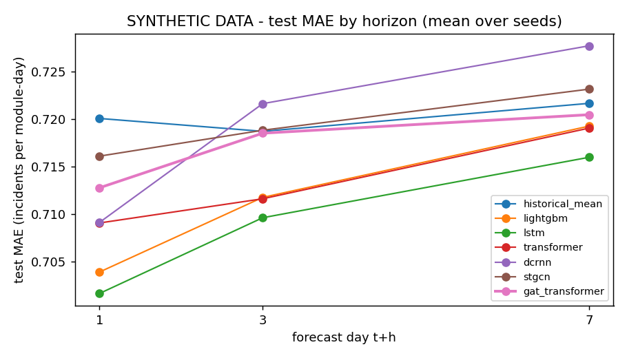
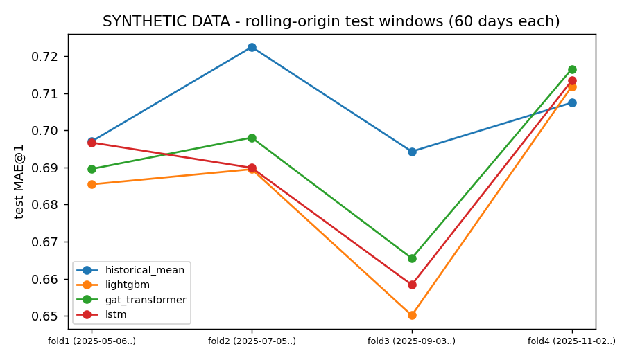
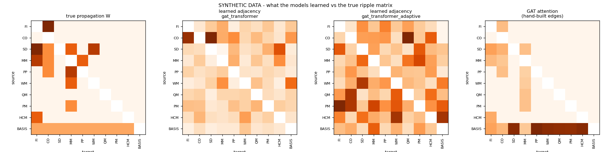
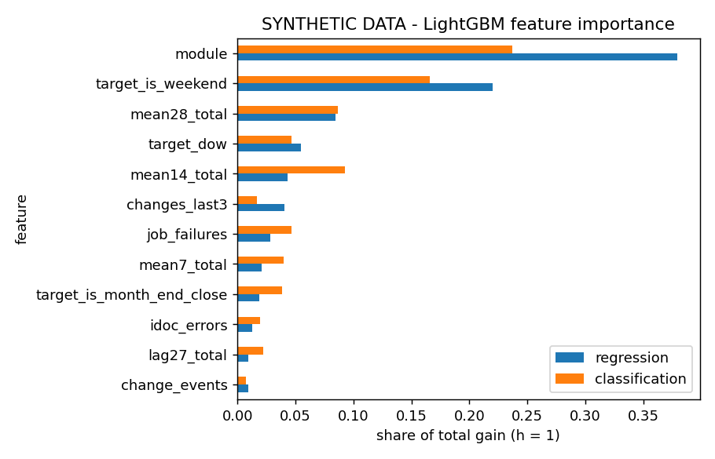

# Results summary (SYNTHETIC DATA)

> **SYNTHETIC DATA.** All numbers come from synthetic data produced by `src/data/generate_synthetic.py`; they say nothing about a real SAP system.

Generated by `python -m src.evaluate` from the files in `results/`. Test split 2025-07-21 .. 2025-12-31; ± = std over seeds.

## 1. Main results (test split)

### regression

| model | seeds | MAE@1 | MAE@3 | MAE@7 | PoissonDev@1 | PoissonDev@7 | P@3@1 |
|---|---|---|---|---|---|---|---|
| naive | 1 | 0.854 | 0.941 | 0.842 | 2.446 | 2.369 | 0.578 |
| seasonal_naive | 1 | 0.842 | 0.841 | 0.842 | 2.392 | 2.369 | 0.571 |
| historical_mean | 1 | 0.720 | 0.719 | 0.722 | 1.099 | 1.097 | 0.686 |
| lightgbm | 1 | 0.704 | 0.712 | 0.719 | 1.051 | 1.084 | 0.673 |
| lstm | 3 | 0.702 ± 0.004 | 0.710 ± 0.008 | 0.716 ± 0.008 | 1.064 ± 0.006 | 1.086 ± 0.005 | 0.685 ± 0.001 |
| transformer | 3 | 0.709 ± 0.006 | 0.712 ± 0.003 | 0.719 ± 0.008 | 1.083 ± 0.007 | 1.095 ± 0.008 | 0.670 ± 0.005 |
| dcrnn | 3 | 0.709 ± 0.002 | 0.722 ± 0.006 | 0.728 ± 0.003 | 1.083 ± 0.005 | 1.112 ± 0.005 | 0.674 ± 0.004 |
| stgcn | 3 | 0.716 ± 0.001 | 0.719 ± 0.002 | 0.723 ± 0.003 | 1.108 ± 0.004 | 1.112 ± 0.006 | 0.660 ± 0.003 |
| gat_transformer | 3 | 0.713 ± 0.007 | 0.719 ± 0.009 | 0.720 ± 0.005 | 1.091 ± 0.013 | 1.100 ± 0.002 | 0.671 ± 0.008 |

### classification

| model | seeds | PR_AUC@1 | PR_AUC@3 | PR_AUC@7 | ROC_AUC@1 | P@3@1 | R@3@1 |
|---|---|---|---|---|---|---|---|
| naive | 1 | 0.136 | 0.124 | 0.132 | 0.538 | 0.142 | 0.345 |
| seasonal_naive | 1 | 0.128 | 0.128 | 0.132 | 0.518 | 0.133 | 0.322 |
| historical_mean | 1 | 0.214 | 0.212 | 0.224 | 0.699 | 0.205 | 0.497 |
| lightgbm | 1 | 0.261 | 0.256 | 0.259 | 0.724 | 0.207 | 0.503 |
| lstm | 3 | 0.232 ± 0.012 | 0.226 ± 0.006 | 0.238 ± 0.004 | 0.701 ± 0.003 | 0.193 ± 0.004 | 0.470 ± 0.011 |
| transformer | 3 | 0.251 ± 0.002 | 0.248 ± 0.005 | 0.255 ± 0.006 | 0.712 ± 0.004 | 0.202 ± 0.008 | 0.491 ± 0.019 |
| dcrnn | 3 | 0.250 ± 0.009 | 0.234 ± 0.003 | 0.241 ± 0.006 | 0.712 ± 0.001 | 0.208 ± 0.006 | 0.506 ± 0.015 |
| stgcn | 3 | 0.230 ± 0.005 | 0.228 ± 0.003 | 0.240 ± 0.003 | 0.698 ± 0.002 | 0.193 ± 0.006 | 0.468 ± 0.015 |
| gat_transformer | 3 | 0.239 ± 0.009 | 0.232 ± 0.010 | 0.242 ± 0.007 | 0.705 ± 0.010 | 0.188 ± 0.008 | 0.456 ± 0.018 |



## 2. Ablations of the main model (GAT-Transformer)

| variant | what | MAE@1 (counts) | PoissonDev@1 (counts) | P@3@1 (counts) | PR_AUC@1 (P1/P2) | R@3@1 (P1/P2) |
|---|---|---|---|---|---|---|
| gat_transformer | main model: hand-built graph + learned adjacency, 28 days, aux on | 0.713 ± 0.007 | 1.091 ± 0.013 | 0.671 ± 0.008 | 0.239 ± 0.009 | 0.456 ± 0.018 |
| gat_transformer_hand_built | hand-built graph only | 0.712 ± 0.003 | 1.085 ± 0.003 | 0.672 ± 0.007 | 0.238 ± 0.005 | 0.463 ± 0.021 |
| gat_transformer_adaptive | learned adjacency only | 0.713 ± 0.001 | 1.096 ± 0.011 | 0.666 ± 0.005 | 0.234 ± 0.006 | 0.460 ± 0.018 |
| gat_transformer_none | no graph (same network) | 0.709 ± 0.006 | 1.083 ± 0.007 | 0.670 ± 0.005 | 0.251 ± 0.002 | 0.491 ± 0.019 |
| gat_transformer__lb14 | look-back 14 days | 0.709 ± 0.007 | 1.100 ± 0.007 | 0.663 ± 0.004 | not run | not run |
| gat_transformer__noaux | without job failures / IDoc errors / change events | 0.713 ± 0.002 | 1.093 ± 0.005 | 0.668 ± 0.008 | not run | not run |

Paired difference to the main model (same seed; MAE / deviance: negative = better; PR-AUC / P@3 / R@3: positive = better):

| variant | MAE@1 (counts) | PoissonDev@1 (counts) | P@3@1 (counts) | PR_AUC@1 (P1/P2) | R@3@1 (P1/P2) |
|---|---|---|---|---|---|
| gat_transformer | - | - | - | - | - |
| gat_transformer_hand_built | -0.000 ± 0.007 | -0.007 ± 0.010 | 0.001 ± 0.014 | -0.001 ± 0.004 | 0.007 ± 0.006 |
| gat_transformer_adaptive | 0.000 ± 0.007 | 0.005 ± 0.002 | -0.005 ± 0.013 | -0.004 ± 0.004 | 0.003 ± 0.016 |
| gat_transformer_none | -0.004 ± 0.009 | -0.008 ± 0.013 | -0.001 ± 0.012 | 0.013 ± 0.008 | 0.034 ± 0.036 |
| gat_transformer__lb14 | -0.004 ± 0.005 | 0.008 ± 0.013 | -0.008 ± 0.006 | - | - |
| gat_transformer__noaux | 0.000 ± 0.009 | 0.002 ± 0.008 | -0.003 ± 0.005 | - | - |

## 3. Rolling-origin stability (test MAE@1, counts)

| model | fold1 (2025-05-06..) | fold2 (2025-07-05..) | fold3 (2025-09-03..) | fold4 (2025-11-02..) | mean ± std |
|---|---|---|---|---|---|
| historical_mean | 0.697 | 0.722 | 0.694 | 0.707 | 0.705 ± 0.013 |
| lightgbm | 0.685 | 0.690 | 0.650 | 0.712 | 0.684 ± 0.026 |
| gat_transformer | 0.690 | 0.698 | 0.666 | 0.716 | 0.692 ± 0.021 |
| lstm | 0.697 | 0.690 | 0.658 | 0.713 | 0.690 ± 0.023 |



## 4. Oracle ceiling (synthetic only)

Forecasts made from the generator's true expected counts. The full oracle also knows the hidden stress state, so no model can beat it on average.

| forecast | MAE@1 | MAE@7 | PoissonDev@1 | PoissonDev@7 | P@3@1 | P@3@7 |
|---|---|---|---|---|---|---|
| oracle_full | 0.659 | 0.656 | 0.979 | 0.968 | 0.698 | 0.709 |
| oracle_ripple_blind | 0.679 | 0.675 | 1.014 | 1.000 | 0.679 | 0.684 |

- Share of test-period variance in daily counts that is predictable even in principle (variance of the true rate / variance of the counts): 0.381
- Ripples' share of expected test incidents: 0.330

## 5. Explainability vs the true propagation matrix

```json
{
  "learned_adjacency_gat_transformer": {
    "runs": 6,
    "spearman_with_true_W": -0.23369955412984295,
    "auc_true_edges_vs_non_edges": 0.32820855614973254,
    "rank_of_hidden_edges_out_of_90": {
      "MM->PP": 12,
      "SD->WM": 61
    },
    "per_target_spearman_all_sources": -0.2926625065707943
  },
  "learned_adjacency_gat_transformer_adaptive": {
    "runs": 6,
    "spearman_with_true_W": -0.09370201865212321,
    "auc_true_edges_vs_non_edges": 0.4375,
    "rank_of_hidden_edges_out_of_90": {
      "MM->PP": 58,
      "SD->WM": 54
    },
    "per_target_spearman_all_sources": -0.1838137523592978
  },
  "gat_attention": {
    "runs": 12,
    "spearman_with_true_strength_on_graph_edges": -0.38016129079984856,
    "per_target_spearman_on_graph_edges": -0.13348599030802347,
    "QM->MM_attention (true strength 0)": 0.15523138642311096,
    "mean_attention_other_edges_into_MM": 0.14414703622460365
  }
}
```



## 6. LightGBM feature importance (gain share, h = 1)

| feature | regression | classification |
|---|---|---|
| module | 0.380 | 0.237 |
| target_is_weekend | 0.220 | 0.166 |
| mean28_total | 0.085 | 0.086 |
| target_dow | 0.055 | 0.047 |
| mean14_total | 0.043 | 0.093 |
| changes_last3 | 0.041 | 0.017 |
| job_failures | 0.028 | 0.047 |
| mean7_total | 0.021 | 0.040 |
| target_is_month_end_close | 0.019 | 0.038 |
| idoc_errors | 0.013 | 0.020 |
| lag27_total | 0.009 | 0.022 |
| change_events | 0.009 | 0.008 |


